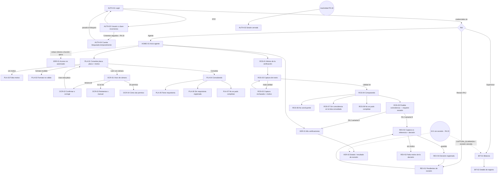

# UX — Prototipo navegable Movil Buscador

Rol: UX. Fuente: `docs/hus/` (HU-01 a HU-08, aprobadas el 2026-11-18) y `PRD.md`. Fecha: 2026-11-18.
Estado: **aprobado por el usuario (vía BA) el 2026-11-18**: elementos no solicitados aprobados, inventario actualizado con HU-03 E5 y HU-05 E5, pendientes de UX convertidos en PA 25 a PA 28. Pendiente: validación con el área usuaria. Alineado con los ADR de ARCH (`docs/arch/`): ADR-0003 (roles), ADR-0008 (vencimiento, PA 23), ADR-0010 (Android, PA 12) y ADR-0011 (motivo PA 21 y formato de placa PA 20). No se generó nada en herramientas externas (PA 14 abierto).

## Proyecto / herramienta

- Herramienta de entrega: wireframes en texto estructurado (este directorio) + **prototipo navegable local** en [`prototipo/`](prototipo/README.md) (HTML sin dependencias ni servicios externos, 2026-11-19). Decisión del humano (2026-11-19): **no se usa bolt.new**; `bolt-prompt.md` queda solo como referencia.
- Canal/formato: **app móvil Android, vertical (teléfono)**. Android es la plataforma de referencia según ADR-0010 (provisional hasta el PA 12). El prototipo es web con marco de teléfono Android.
- Idioma de la interfaz: español (Perú).
- Roles (ADR-0003): **agente** (el "usuario en campo" de las HUs), **revisor** y **supervisor** (el "responsable del servicio" de HU-02/HU-07, que consulta la bitácora). Un agente nunca revisa su propia consulta.

## Contenido

| Archivo | Qué contiene |
|---|---|
| [wireframes/HU-01-iniciar-sesion.md](wireframes/HU-01-iniciar-sesion.md) | Login, credenciales inválidas, sesión vencida |
| [wireframes/HU-02-acceso-por-rol.md](wireframes/HU-02-acceso-por-rol.md) | Inicio por rol, acceso no autorizado |
| [wireframes/HU-03-consultar-placa.md](wireframes/HU-03-consultar-placa.md) | Formulario de placa, validaciones, resultados, fuente caída |
| [wireframes/HU-04-capturar-placa-ocr.md](wireframes/HU-04-capturar-placa-ocr.md) | Cámara de placa, confirmación, lectura fallida, sin permiso |
| [wireframes/HU-05-verificar-rostro.md](wireframes/HU-05-verificar-rostro.md) | Motivo, captura de rostro, calidad rechazada, tres resultados |
| [wireframes/HU-06-revisar-coincidencia.md](wireframes/HU-06-revisar-coincidencia.md) | Cola del revisor, comparación lado a lado, decisión, vista del agente |
| [wireframes/HU-07-bitacora-consultas.md](wireframes/HU-07-bitacora-consultas.md) | Bitácora de solo lectura y detalle de registro |
| [wireframes/HU-08-simuladores-fuentes.md](wireframes/HU-08-simuladores-fuentes.md) | Sin pantallas propias; dónde se ven sus errores; panel de demo |
| [prototipo/index.html](prototipo/index.html) | Prototipo navegable local, HU-01 a HU-08, tres roles ([notas de entrega](prototipo/README.md)) |
| [prototipo/GUION-VALIDACION.md](prototipo/GUION-VALIDACION.md) | Guion de recorrido de 15 min para la validación del 1-dic-2026 |
| [bolt-prompt.md](bolt-prompt.md) | Solo referencia: no se usa bolt.new (decisión del humano, 2026-11-19) |

## Mapa de flujos

## Inventario de pantallas y escenarios cubiertos

| ID | Pantalla / estado | HU · Escenario Gherkin |
|---|---|---|
| AUTH-01 | Login | HU-01 · E1 Usuario autorizado inicia sesión |
| AUTH-02 | Usuario o clave incorrectos | HU-01 · E2 Credenciales incorrectas |
| AUTH-03 | Sesión cerrada por inactividad | HU-01 · E3 La sesión vence por inactividad |
| AUTH-04 | Cuenta bloqueada temporalmente | HU-01 · E4 Demasiados intentos fallidos (provisional ADR-0011, PA 19) |
| HOME-01 | Inicio agente | HU-02 · E1 El usuario en campo ve solo sus funciones |
| ERR-01 | Acceso no autorizado | HU-02 · E2 Intento de usar una función de otro rol |
| PLA-01 | Formulario placa + motivo | HU-03 · E1 (When) |
| PLA-02 | Falta motivo | HU-03 · E2 El usuario no indica el motivo |
| PLA-03 | Formato no válido | HU-03 · E4 La placa no tiene un formato válido |
| PLA-04 | Consultando | Transición (sin escenario propio) |
| PLA-05 | Placa con requisitoria | HU-03 · E1 (Then) |
| PLA-06 | Sin requisitoria registrada | HU-03 · E5 La placa no tiene requisitoria en la fuente consultada |
| PLA-07 | No se pudo completar la consulta | HU-03 · E3 Fuente no disponible; HU-08 · E3 |
| OCR-01 | Visor de cámara de placa | HU-04 · E1 (When) |
| OCR-02 | Confirmar o corregir lectura | HU-04 · E1 (Then) |
| OCR-03 | Lectura fallida | HU-04 · E2 La placa no se puede leer |
| OCR-04 | Sin permiso de cámara | HU-04 · E3 El usuario negó el permiso |
| ROS-01 | Motivo de la verificación | HU-05 · E1 (Dado: indicó el motivo); regla transversal de motivo |
| ROS-02 | Captura de rostro | HU-05 · E1 (When) |
| ROS-03 | Captura rechazada con motivo | HU-05 · E2 No pasa el control de calidad |
| ROS-04 | Comparando | Transición |
| ROS-05 | Posible coincidencia — requiere revisión | HU-05 · E1 (Then); HU-06 · E3 (estado Pendiente) |
| ROS-06 | No concluyente | HU-05 · E3 Banda intermedia |
| ROS-07 | Sin coincidencia en la lista consultada | HU-05 · E4 |
| ROS-08 | No se pudo completar la verificación | HU-05 · E5 El servicio de comparación no responde; HU-08 · E3 |
| VER-01 | Mis verificaciones | HU-06 · E1 ("el usuario en campo ve el resultado") y E3 ("ve el estado Pendiente"); HU-06 · E4 Nadie revisa la coincidencia en 24 horas (provisional ADR-0008, PA 23) |
| VER-02 | Detalle de mi verificación | HU-06 · E1 / E3 / E4 (vencida, PA 23) |
| REV-01 | Pendientes de revisión | HU-06 · E1 (Dado) y E3 (sin alertas); HU-06 · E4 (la vencida sale de la cola y no aparece en REV-01, PA 23) |
| REV-02 | Comparación lado a lado + decisión | HU-06 · E1 |
| REV-03 | Falta motivo de la decisión | HU-06 · E2 |
| REV-04 | Decisión registrada | HU-06 · E1 (Then) |
| BIT-01 | Bitácora | HU-07 · E1; HU-07 · E2 (sin controles de edición); HU-06 · E4 (eventos "Revisión vencida" y "Captura eliminada") |
| BIT-02 | Detalle de registro | HU-07 · E3 Datos sensibles (ID de captura + score, sin imagen) |
| DEMO | Panel de demo (solo prototipo) | HU-08 · E1–E3 (simular respuestas); alterna variantes de PA |

## Cómo se aplican las reglas de negocio clave

| Regla | Dónde se ve en el diseño |
|---|---|
| 1. Nunca "identificado" | Solo existen tres textos de resultado facial: ROS-05, ROS-06, ROS-07. La palabra "identificado" no aparece en ninguna pantalla, ni siquiera tras la revisión (VER-02 dice "Revisor: coincidencia confirmada"). ROS-05 agrega "Esto no es una identificación". |
| 2. Motivo obligatorio antes de consultar | Placa: el motivo está en el mismo formulario y "Consultar" no envía sin él (PLA-02). Rostro: el motivo es el paso 1; la cámara no se abre sin él (ROS-01). |
| 3. Mala calidad se rechaza con motivo visible | ROS-03 muestra el motivo concreto y dice "La captura no se envió a comparar". El único botón es "Repetir captura". |
| 4. Nada automático antes de la revisión | ROS-05 y REV-01 no tienen alertas, sonidos, notificaciones push ni botones de acción operativa. El estado visible es "Pendiente de revisión". |
| 5. Sin identificación masiva ni lectura continua | OCR-01 y ROS-02 capturan **una** imagen solo al tocar "Capturar". No hay video continuo, ni lectura automática, ni carga desde galería, ni lote. ROS-02 pide "una sola persona" y ROS-03 rechaza más de un rostro. |

## Decisiones de diseño aplicadas

- **Canal**: app móvil vertical. El PRD dice "dispositivo móvil"; la plataforma (PA 12) no cambia el flujo.
- **Motivo en placa vs. rostro**: en placa va en el mismo formulario, porque HU-03 E2 parte de "ingresó una placa" e intenta consultar sin motivo. En rostro va como paso previo, porque HU-05 E1 dice que el motivo se indicó antes de capturar, y así no se toma una foto de una persona sin motivo registrado.
- **Colores de resultado** (no hay regla de negocio sobre color):
  - Rojo solo para "Placa con requisitoria" (PLA-05).
  - Ámbar para "Posible coincidencia — requiere revisión" y "Pendiente de revisión".
  - Gris o azul neutro para "No concluyente", "Sin coincidencia en la lista consultada", "Sin requisitoria registrada" y los errores.
  - **No se usa verde** en ningún resultado, para que nada se lea como "persona/vehículo limpio".
- **Errores nunca parecen resultados**: PLA-07 y ROS-08 usan otro ícono y otro color, y siempre ofrecen "Reintentar".
- **Lectura OCR siempre confirmada**: OCR-02 devuelve la placa al formulario PLA-01. La consulta solo sale cuando el usuario toca "Consultar" con el motivo puesto.
- **Cámara de rostro**: por defecto usa la trasera, porque el usuario fotografía a otra persona. No se agrega botón para cambiar de cámara (la HU no lo pide).
- **Score**: no se muestra al agente (supuesto de HU-05). Al revisor no se le muestra hasta que se decida el PA 26.
- **Marcas de Punto Abierto en pantalla**: toda zona que depende de un PA lleva una etiqueta ámbar punteada "PA nn — pendiente". En el prototipo se pueden ocultar desde el panel de demo para la sesión de validación.
- **Variantes de PA en el prototipo**: el panel de demo alterna las variantes de PA 2, 7 y 15 sin asumir ninguna. El PA 21 ya tiene un diseño provisional único (ADR-0011). El área usuaria puede verlas y elegir durante la validación.

## Puntos abiertos que impactan el diseño

| PA | Pregunta | Dónde impacta | Cómo se diseñó sin asumirlo |
|---|---|---|---|
| **PA 2** | ¿Quién revisa: el mismo agente, un supervisor o una central? | ROS-05, VER-01, REV-01..04, HOME por rol | **Variante A (rol separado)**: ROS-05 → "Ver en Mis verificaciones"; el revisor tiene su propio inicio REV-01. **Variante B (fusión HU-05 + HU-06)**: ROS-05 muestra "Revisar ahora", que abre REV-02 con el mismo usuario. **Choca con ADR-0003** (quien consulta nunca aprueba su propia coincidencia): se mantiene solo para la validación, marcada "requiere reabrir ADR-0003". Por defecto, el prototipo usa la variante A. REV-02 es igual en ambas. El PRD ahora lista también las opciones **C** (autorrevisión en modo operativo con ratificación posterior) y **D** (central en tiempo real): **no se diseñan hasta que el MININTER decida**. |
| **PA 7** | ¿1:1 o lista acotada? | ROS-01, ROS-05, ROS-07, REV-02 | **Lista** (variante por defecto del prototipo, porque así están escritos los textos de HU-05): ROS-01 solo pide el motivo, REV-02 muestra un selector de candidatos. **1:1**: ROS-01 agrega el campo "Identidad declarada" (tipo de dato por definir) y REV-02 muestra una sola referencia. Los textos de ROS-05/07 quizá deban cambiar en 1:1 ("lista consultada"); se marca. |
| **PA 15** | ¿Qué datos muestra el resultado? | PLA-05, PLA-06, REV-02 (datos de la persona de referencia), ROS-05 | Se reserva un bloque "Datos adicionales" con marca PA 15 y **sin campos inventados**. Variantes: "Solo estado" / "Estado + bloque de datos (campos por definir)". |
| **PA 21** | ¿Motivo libre o lista cerrada? | PLA-01, ROS-01 (mismo componente) | Provisional según ADR-0011: **catálogo cerrado configurable más "Otro"**; "Otro" exige un texto de 10 caracteres o más. En el prototipo, las opciones se muestran como "Opción 1/2/3 (por definir)": el catálogo inicial que propone ARCH **no se muestra como decidido**. |
| PA 12 | Dispositivos | Marco del prototipo, OCR-04 | Provisional según ADR-0010: Android de referencia. Marco de teléfono Android y rutas de permisos de Android. |
| PA 18 | Tiempo de inactividad | AUTH-03 | Se diseña el estado de cierre. No se agrega aviso de cuenta regresiva. |
| PA 19 | Intentos antes de bloquear | AUTH-02, AUTH-04 | Provisional según ADR-0011 y HU-01 E4 (aprobado): 5 intentos seguidos → bloqueo de 15 min. AUTH-04 muestra cuándo se puede volver a intentar, no indica si la clave era correcta y lleva la marca PA 19. AUTH-02 no muestra intentos restantes. |
| PA 20 | Formatos de placa | PLA-03 | Validación provisional (ADR-0011, no verificada contra la normativa): 3 caracteres alfanuméricos + guion + 3 dígitos (ej. `ABC-123`). **El error muestra el formato esperado.** Se marca PA 20. |
| PA 22 | Máximo de candidatos | REV-02 | Selector de candidatos con N variable. El prototipo usa 3 (sugerencia de la skill, sin confirmar) y se marca. |
| PA 23 | ¿Qué pasa si nadie revisa? | REV-01, VER-01, VER-02, BIT-01/02 | Provisional según ADR-0008: a las 24 h sin revisión, la revisión pasa a "Vencida". El agente ve "No concluyente — verifique por otros medios" (VER-01/02). La vencida sale de la cola del revisor y no aparece en REV-01 (HU-06 E4; la captura ya se borró). El supervisor la ve en la bitácora como "Revisión vencida" y "Captura eliminada" (BIT-01/02). Todo lleva la marca PA 23. Sin estado "Escalada". |
| PA 24 | ¿Quién ve la bitácora, desde dónde, con qué filtros? | BIT-01/02 | Pantalla móvil del rol supervisor (ADR-0003). Los filtros llevan marca PA 24. Toda la pantalla lleva la marca. |
| PA 25 | ¿Se avisa a la persona fotografiada antes de capturar su rostro? ¿Cómo? | ROS-02 | Se reserva un bloque punteado "Aviso a la persona — por definir" sobre el botón Capturar, con marca PA 25. **No se diseñó el contenido del aviso ni un paso de consentimiento.** |
| PA 26 | ¿El revisor ve el score? | REV-02 | Bloque punteado "Score — por definir" con marca PA 26. No se muestra el valor. |
| PA 27 | ¿El agente ve el motivo del revisor? | VER-02 | Bloque punteado "Motivo del revisor — por definir" con marca PA 27. Solo se ve la decisión y la fecha. |
| PA 28 | Redacción de una coincidencia confirmada | VER-02 | Se muestra provisionalmente "Revisión: coincidencia confirmada por el revisor" con marca PA 28 (validar con el área legal). |

## Elementos no solicitados por las HUs (aprobados por el usuario el 2026-11-18)

1. **"Mis verificaciones" (VER-01/02) en el inicio del agente**: HU-06 exige que el agente vea el estado y el resultado de la revisión, pero no dice dónde.
2. **Botón "Cerrar sesión"**: HU-01 habla de que la sesión "se cierre cuando corresponda", pero ningún escenario cubre el cierre manual.
3. **Franja persistente "DATOS SINTÉTICOS — PROTOTIPO"**: viene del enfoque MVP y del supuesto de HU-07 ("registros marcados como sintéticos"). No es un requisito de pantalla.
4. **Pantalla PLA-06 "Sin requisitoria registrada en la fuente consultada"**: ahora la cubre HU-03 E5, con la misma redacción.
5. **ROS-08 (error en la verificación facial)**: ahora la cubre HU-05 E5.
6. **Subtítulo de ROS-05** "Esto no es una identificación. Un revisor debe validar la coincidencia." y **subtítulo de ROS-07** "La comparación se hizo solo contra la lista disponible.": refuerzan la regla 1; son texto agregado.
7. **Panel de demo**: herramienta del prototipo para simular respuestas de los simuladores y alternar variantes de PA. No es parte del producto.
8. **Placas sintéticas adicionales** (`DEF-456` sin requisitoria, `GHI-789` fuente caída): solo `ABC-123` viene de la HU.

## Pendientes de negocio detectados por UX

Quedaron registrados en el PRD como PA 25 (aviso a la persona fotografiada), PA 26 (score al revisor), PA 27 (motivo del revisor visible) y PA 28 (redacción de coincidencia confirmada). Ver la tabla de Puntos Abiertos de arriba y las marcas en ROS-02, REV-02 y VER-02.

## Fuera de alcance respetado

- Identificación masiva: no hay búsqueda en lote, carga desde galería ni comparación de varios rostros a la vez.
- Vigilancia indiscriminada: no hay video continuo, lectura automática de placas ni captura sin motivo.
- Integración con fuentes reales: todo resultado viene de simuladores (panel de demo).
- Pantalla de administración de usuarios (conflicto C1): no se diseñó. Los usuarios y roles sintéticos vienen precargados.
- Acciones automáticas a partir de una coincidencia: ninguna.
- Políticas de seguridad avanzadas (MDM, llaves, directorio): sin UI.

## Checklist de calidad

- [x] Leí las 8 HUs completas, el índice (C1–C4) y los PA del PRD.
- [x] Cada escenario Gherkin tiene una pantalla o estado asociado (tabla de inventario).
- [x] No diseñé pantallas ni campos sin justificación; lo derivado está en "no solicitados".
- [x] No inventé reglas de negocio: motivos, campos de resultado y formatos quedan como "por definir".
- [x] Marqué en pantalla las ambigüedades (PA 2, 7, 15, 21 y demás).
- [x] Documenté las decisiones de interfaz.
- [x] Revisé los artefactos: no se ejecutó ninguna herramienta generadora. Cuando bolt.new genere el prototipo, hay que revisarlo contra la lista "no solicitados" (instrucción incluida en `bolt-prompt.md`).
- [x] Respeté el fuera de alcance.
- [x] Un archivo por HU en `docs/ux/wireframes/`.
- [x] Cada pantalla indica qué escenario cubre.
